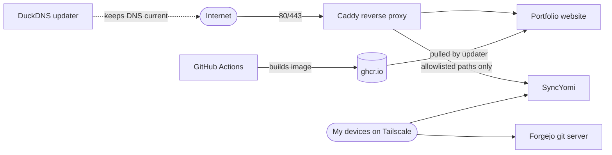

# home-lab
 
A self-hosted server I run on a repurposed laptop. It hosts my portfolio site, a private Git server and a sync service for my phone and tablet. I built it to learn how to run and secure real services on Linux, and this repo holds the configuration.
 
> Only configuration lives here. Secrets (`.env`), databases and runtime data are git-ignored on purpose.
 
## Hardware and OS
 
| | |
|---|---|
| Machine | Acer Aspire ES1-520 (AMD A4-5000, ~8 GB RAM after a RAM upgrade) |
| OS | Debian, headless (no desktop), connected over Wi-Fi |
| Access | SSH over the LAN or Tailscale |
 
An old, slow machine is a useful constraint: every container has a memory limit, and I measure before I add anything.
 
## Architecture
 

 
| Service | What it does | Who can reach it |
|---|---|---|
| `caddy` | Reverse proxy, automatic HTTPS | Public (80/443) |
| `duckdns` | Keeps my DuckDNS records pointing at my home IP | Outbound only |
| `website` | My portfolio, built from [Portofolio](https://github.com/joaom2005/Portofolio) | Public, through Caddy |
| `syncyomi` | Self-hosted sync server for my manga reader apps | Public, but only 2 API paths; full UI over Tailscale only |
| `forgejo` | Private Git server | Tailscale only |
 
## How the site gets deployed
 
1. I push to the portfolio repo.
2. GitHub Actions builds a container image and publishes it to `ghcr.io`.
3. On the server, a small updater checks the registry about every 10 seconds and restarts the `website` container when a new image appears. <!-- TODO: name the tool/script that does this and link it -->
Building happens on GitHub's runners, not on the laptop. The laptop's CPU would be slow at it, and builds shouldn't compete with the live site.
 
## Security decisions
 
- **SSH:** key-only login, root login disabled. `ufw` only allows SSH from my home LAN and over Tailscale, so it isn't reachable from the internet.
- **Least exposure:** only Caddy publishes ports 80/443. Forgejo listens on `127.0.0.1` and SyncYomi on my Tailscale address, so containers aren't exposed by accident. (Docker publishes ports through its own iptables rules, which **bypass ufw**, so for containers the port binding in the compose file is the real control.)
- **Private services stay private:** Forgejo is only reachable through Tailscale, and registration is disabled.
- **Minimal public API surface:** SyncYomi's public hostname forwards only `/api/sync/content` (GET/PUT) and `/api/sync/event` (POST). Everything else is dropped by Caddy. Both endpoints still require an API key.
- **Security headers** (HSTS, nosniff, frame deny, referrer and permissions policies) on the website, and the `Server` header removed.
- **Limits and read-only mounts:** every container has a memory limit, and the Caddyfile is mounted read-only.
- **Automatic security updates** on the host (`unattended-upgrades`).
- **Secrets** stay in `.env` files that are git-ignored. `.env.example` files show what is needed.
## Things that went wrong (and what I learned)
 
<!-- Rewrite these in your own words. Keep only what you actually remember. -->
 
- **Bots found the sync endpoint within minutes.** After exposing SyncYomi through Caddy, the access logs showed scanners probing `/console`, `/server-status`, `/about` and similar paths. I checked which paths the app really uses and switched to an allowlist, which returns nothing for everything else.
- **502 from Caddy: "no such host".** Caddy and SyncYomi were on different Docker networks, so the name didn't resolve. Putting them on a shared network fixed it.
- **Sync timeouts.** With a large library the SyncYomi container hit its memory limit. I checked `docker stats` and the OOM flag, then raised the limit.
- **A strict Content-Security-Policy broke my site.** The page uses inline scripts, which `script-src 'self'` blocks, so the theme switcher and images stopped working. For now I run without a CSP header. <!-- TODO: decide: hash-based CSP later? -->
## What's not done yet
 
- **Off-site backups.** I use `restic` for snapshots, but the repository is currently on the same disk as the data. It protects against mistakes, not disk failure. A second drive or cloud copy is the next step.
- **Intrusion banning** (CrowdSec or similar) and **uptime monitoring**.
- **CSP** for the website (see above).
- **Image version pinning** for the `latest` tags.
## Run it yourself
 
Requires Docker with the Compose plugin.
 
```bash
docker network create web
cd duckdns && cp .env.example .env     # add your DuckDNS token
docker compose up -d
# repeat for caddy, website, syncyomi, forgejo
```
 
Edit these before use: the domains in `caddy/Caddyfile`, `SUBDOMAINS` in `duckdns/compose.yml`, `FORGEJO__server__ROOT_URL` in `forgejo/compose.yml`, and the Tailscale IP in `syncyomi/compose.yml`.
 
## Layout
 
```
caddy/      Reverse proxy + Caddyfile
duckdns/    Dynamic DNS updater
forgejo/    Git server
syncyomi/   Sync server
website/    Portfolio container
```
 
